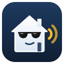

# Domestic Intelligence Service

*Heimischer Nachrichtendienst* · domain `presence_notify`

> [!WARNING]
> **Early beta (0.3.0b1).** This integration is at the very beginning of its development. Expect bugs, breaking changes to settings and actions, and missing features. Please don't rely on it for important notifications yet, and report problems via [Issues](https://github.com/deladus/ha-presence-notify/issues).
>
> **Frühe Beta (0.3.0b1).** Die Integration steht noch ganz am Anfang. Fehler, inkompatible Änderungen an Einstellungen und Aktionen sowie fehlende Funktionen sind zu erwarten. Bitte noch nicht für wichtige Benachrichtigungen verwenden. Probleme gern über [Issues](https://github.com/deladus/ha-presence-notify/issues) melden.

Notifications for Home Assistant that reach whoever is **at home and in earshot**, and don't get lost when nobody is home.

*Deutsche Kurzbeschreibung weiter unten.*

## What it does

One action, `presence_notify.send`, replaces your notification scripts:

- **Someone is home:** push to every person who is home, and announce on the speakers of rooms where someone is detected. Rooms without sensors always get announcements. If nobody is detected anywhere, all speakers are used. No announcements during quiet hours.
- **Nobody is home:** the notification is **stored** (it survives restarts). Identical notifications are merged and counted ("3 times, first at 09:10").
- **Coming home:** The service waits until motion is detected in a **return room** (e.g. living room or kitchen) rather than using a fixed delay. Then the briefing is announced there, **as one briefing**, even during quiet hours. With an AI task entity (e.g. Google Gemini), several notifications are summarized into a natural announcement. Without one, a short list is read out.
- The push with the briefing goes out **immediately on arrival** (optional: wait for motion instead).
- **Pet mode** (optional): motion only counts after an entry door was opened or unlocked, so pets or a robot vacuum don't trigger the briefing before you are in the room.
- If everybody leaves again before reaching a return room, notifications stay stored.

Speakers: Alexa Media Player devices are announced directly via `notify.alexa_media` (announce). Any other `media_player` is announced via `tts.speak` with a TTS engine you choose.

## Installation

**Home Assistant 2026.11 or newer (Marketplace):**

1. *Settings → Marketplace* → **Add from link** (top right).
2. Enter `deladus/ha-presence-notify`.
3. Install **Domestic Intelligence Service**. While there is only a beta, enable pre-releases for it. Then restart Home Assistant.
4. *Settings → Devices & services → Add integration → Domestic Intelligence Service*.

**Older versions:** add the repository as a custom repository (type *Integration*) in HACS, install and restart.

## Setup

1. **General:** quiet hours, optional **home source**, optional AI task entity, optional TTS engine.
   The home source can be a house mode select (e.g. `Home / Away / Vacation`), an "anyone home" sensor or an alarm panel. You pick which states mean "home". If set, it decides whether notifications are stored. The persons then only define who gets push notifications (if none of them is tracked as home, all of them get it).
2. **Persons:** pick persons, then the notify service for each of them (tip: a notify group with all of a person's devices).
3. **Rooms:** name, speaker, presence entities, and whether it is a return room. Presence entities can be any `binary_sensor`, `light`, `switch`, `media_player`, `input_boolean` or `device_tracker`. `on`, `home` or `playing` counts as someone being there, so a TV or a hobby room light can count too.

Everything can be changed later via *Configure*.

## Testing with helpers

You can try everything without touching your real setup:

1. Create on/off helpers, e.g. `input_boolean.dis_test_person` (on = at home) and `input_boolean.dis_test_motion`.
2. In the setup, pick the person helper as "person" and the motion helper as presence entity of a return room.
3. Switch the person helper off, send a few notifications, switch it on (push arrives), then switch the motion helper on (announcement plays).

## Actions

| Action | Purpose |
|---|---|
| `presence_notify.send` | `title`, `message`, optional `data` (push extras such as `image`, `actions`), `speakers` (limit to these), `ignore_quiet_hours` |
| `presence_notify.deliver_pending` | Deliver stored notifications now as one briefing |
| `presence_notify.clear_pending` | Delete stored notifications |
| `presence_notify.ask` | Yes/no question by push with buttons (optionally also by Alexa). Returns `answer` (`yes`/`no`/`timeout`) and `by`. See [Alexa questions](docs/alexa-rueckfragen.md) |

```yaml
action: presence_notify.send
data:
  title: Washing machine
  message: The laundry is done.
```

## Alexa questions (experts only)

`presence_notify.ask` always works by push with buttons. With the switch **Alexa questions (experts only)** in the general settings, Alexa also asks in the room where someone is detected. This needs the [Alexa Actionable Notifications](https://github.com/keatontaylor/alexa-actions) skill and its script – see the **[guide](docs/alexa-rueckfragen.md)** (German/English).

## Entities

- Entity IDs follow your language (e.g. `sensor.heimischer_nachrichtendienst_…` in German)
- `sensor.domestic_intelligence_service_stored_notifications`: number of stored notifications (attribute `items`)
- `sensor.domestic_intelligence_service_last_delivery`
- `binary_sensor.domestic_intelligence_service_waiting_for_return`
- Buttons: *Deliver now*, *Clear stored notifications*
- Event `presence_notify_delivered` (`count`, `speakers`) after each delivery

## Known limitations

- Pets can trigger presence sensors in a return room – use pet mode. A pet running ahead of you right after the door opens can still trigger it.
- Camera images: when a notification with `image: /api/camera_proxy/camera.x` is stored, a snapshot is saved to the media folder (`/media/presence_notify`, requires login) so it shows the right moment. One picture is attached to the briefing push; several are pushed one by one, grouped. Snapshots are deleted 15 minutes after delivery.
- Other push extras (e.g. actions) of individual notifications are dropped in a summarized briefing.

---

## Deutsch

Der Heimische Nachrichtendienst schickt Benachrichtigungen an alle, die zu Hause sind (Push), und sagt sie auf den Lautsprechern in Hörweite an. Ist niemand da, werden sie gespeichert. Gleiche Meldungen werden dabei gezählt statt doppelt abgelegt. Nach der Heimkehr wartet die Integration auf die erste Bewegung in einem Heimkehr-Raum und spielt dort **ein** Briefing ab (der Push kommt schon bei der Ankunft), auf Wunsch per KI zusammengefasst und auch während der Ruhezeit. Einrichtung komplett über die Oberfläche, Oberfläche auf Deutsch und Englisch.

## License

MIT

*Developed with AI assistance. / Mit KI-Unterstützung entwickelt.*
